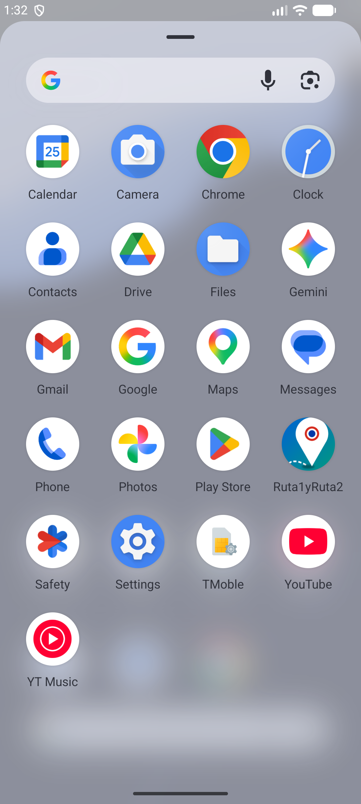
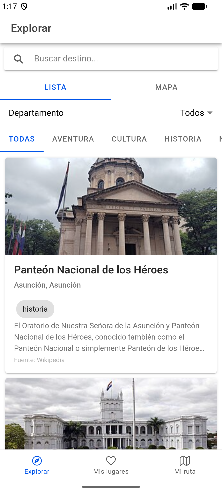
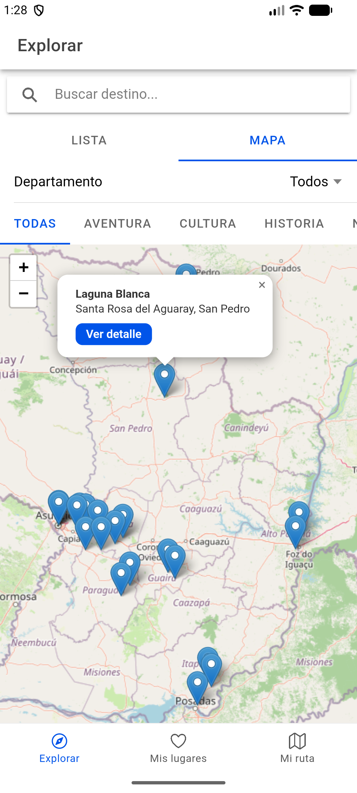
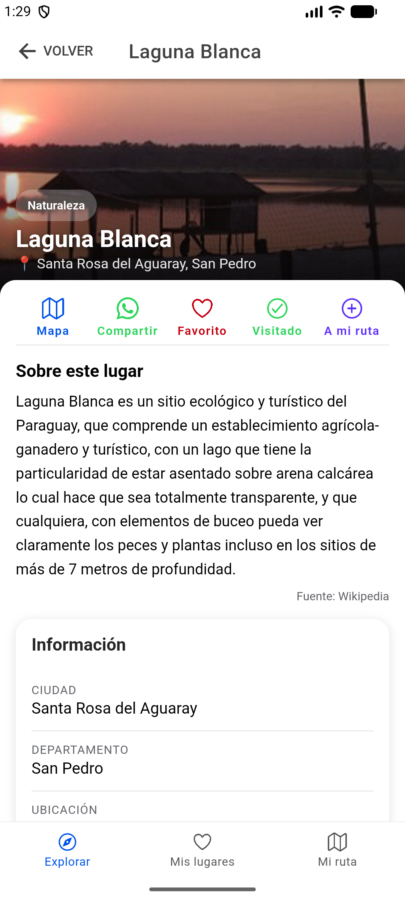
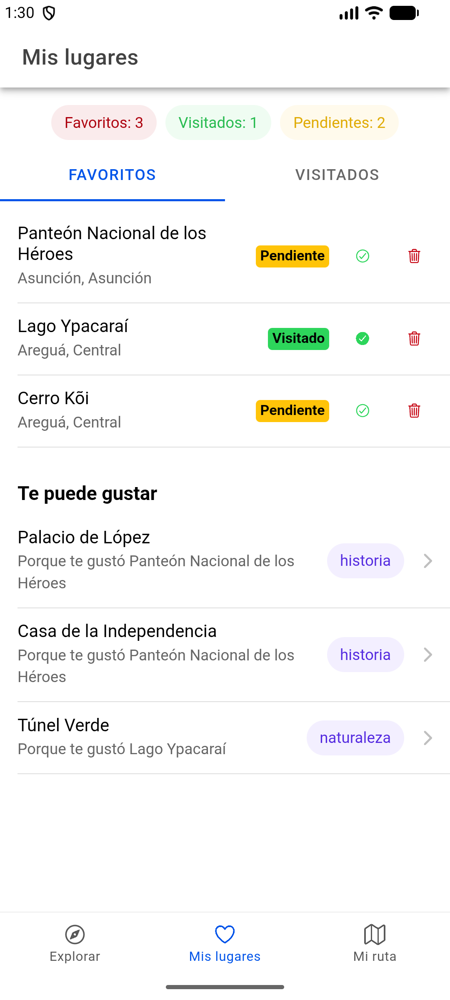
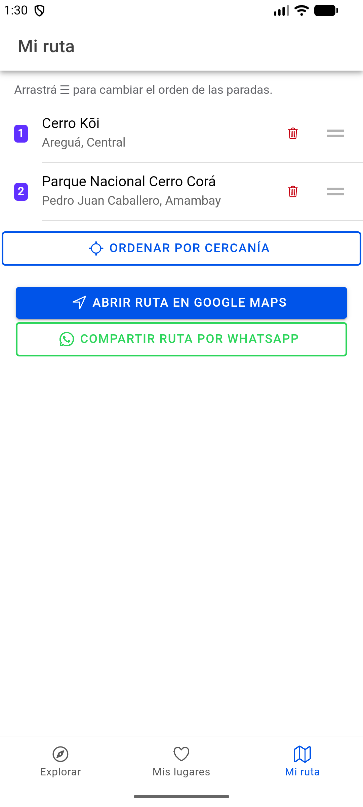

# Ruta1yRuta2 — Descubrí Paraguay

### Explorá Paraguay, descubrí nuevos destinos y planificá tu próxima aventura.

Ruta1yRuta2 es una guía turística desarrollada con **Ionic 9 y Angular 22**, que permite explorar lugares turísticos de Paraguay, consultar información, guardar destinos favoritos, registrar lugares visitados y organizar rutas de viaje mediante Google Maps.

El proyecto fue desarrollado como trabajo final de **Programación VI**.

**Aplicación publicada (PWA):** https://ruta1yruta2-py.netlify.app

**Autora:** Angélica González

---

## Integrantes

- **Angélica González:** desarrollo completo del proyecto.

---

## Funcionalidades

### Explorar destinos

- 22 lugares turísticos distribuidos en 9 departamentos de Paraguay.
- Buscador por nombre, ciudad o departamento.
- Filtros por departamento y categoría:
  - Naturaleza.
  - Historia.
  - Cultura.
  - Aventura.
  - Religión.
- Dos modalidades de visualización:
  - **Vista Lista:** tarjetas con fotografías y descripciones de los destinos.
  - **Vista Mapa:** ubicación de los destinos mediante marcadores sobre OpenStreetMap.
- Descripciones y fotografías obtenidas de Wikipedia.
- Información y fotografías propias para los lugares que no cuentan con artículo en Wikipedia.

### Detalle de un destino

Cada destino cuenta con una pantalla de detalle que presenta:

- Fotografía principal.
- Nombre y categoría.
- Ciudad y departamento.
- Coordenadas geográficas.
- Descripción del lugar.

Además, permite:

- Abrir la ubicación en Google Maps.
- Compartir el destino por WhatsApp.
- Agregar o quitar de favoritos.
- Marcar como visitado.
- Agregar o quitar de Mi ruta.

### Mis lugares

Permite organizar los destinos guardados mediante:

- Lista de favoritos.
- Lista de lugares visitados.
- Lista de lugares pendientes.
- Estadísticas de los destinos guardados.
- Recomendaciones personalizadas mediante **Te puede gustar**, según las categorías y departamentos de los lugares favoritos.

### Mi ruta

Permite organizar itinerarios de viaje con las siguientes opciones:

- Agregar y quitar destinos.
- Reordenar las paradas mediante arrastrar y soltar.
- Ordenar los destinos por cercanía desde la ubicación actual.
- Abrir la ruta completa en Google Maps.
- Compartir el itinerario por WhatsApp.

### PWA y Android

La aplicación cuenta con dos modalidades de uso:

**PWA (Progressive Web App)**
- Se puede instalar desde el navegador del celular.
- Permite acceder desde la pantalla de inicio.
- Puede utilizarse sin conexión para consultar los datos y recursos guardados localmente.

**Android**
- Cuenta con una versión APK generada mediante Capacitor.
- Permite instalar la aplicación en dispositivos Android.

---

## Capturas de pantalla

A continuación se muestran las principales interfaces de Ruta1yRuta2.

### Ícono de la aplicación



### Explorar destinos

**Vista Lista**



**Vista Mapa**



### Detalle de un destino



### Mis lugares



### Mi ruta



---

## Tecnologías utilizadas

| Tecnología | Aplicación en el proyecto |
|---|---|
| Ionic 9 | Componentes e interfaz de la aplicación. |
| Angular 22 | Estructura y lógica de la aplicación. |
| TypeScript | Desarrollo de la lógica y los servicios. |
| Capacitor 8 | Integración y generación de la versión Android. |
| Leaflet | Visualización e interacción con mapas. |
| OpenStreetMap | Información cartográfica. |
| API REST de Wikipedia | Obtención de descripciones y fotografías. |
| Angular Service Worker | Implementación de la PWA. |
| LocalStorage | Almacenamiento local de favoritos, visitados y rutas. |

### Componentes de Ionic utilizados

Entre los componentes utilizados se encuentran:

`ion-tabs`, `ion-card`, `ion-searchbar`, `ion-select`, `ion-segment`, `ion-chip`, `ion-list`, `ion-item`, `ion-badge`, `ion-button`, `ion-icon`, `ion-spinner` y `ion-reorder-group`, entre otros.

### Servicios de Angular

Los servicios utilizan `providedIn: 'root'` y se inyectan mediante `inject()`.

| Servicio | Responsabilidad |
|---|---|
| `DestinosService` | Lee los lugares desde `assets/data/destinos.json`. |
| `WikipediaService` | Obtiene los resúmenes y fotografías mediante la API de Wikipedia. |
| `MisLugaresService` | Gestiona favoritos y visitados en LocalStorage. |
| `RutaService` | Administra y reordena las paradas de la ruta. |
| `UbicacionService` | Obtiene la ubicación del usuario y calcula distancias. |
| `RecomendacionesService` | Sugiere destinos según los favoritos. |
| `CompartirService` | Genera enlaces y textos para WhatsApp y Google Maps. |

Las direcciones de los recursos y configuraciones se encuentran organizadas en `src/environments/`.

---

## Requisitos previos

Para instalar y ejecutar el proyecto se necesita:

- **Node.js:** versión 22 o superior (probado con v22.23.2).
- **npm:** versión 11 o superior (probado con 11.19.1).
- **Git**.
- **Conexión a internet** para consultar las fotografías de Wikipedia y utilizar los mapas.

Para generar el APK de Android también se necesita:

- Android Studio.
- JDK 21.

No es necesario instalar Ionic globalmente, ya que se utilizan comandos mediante `npx`.

---

## Instalación y ejecución

### 1. Clonar el repositorio

```bash
git clone https://github.com/anggiegg05-coder/Ruta1yRuta2.git
```

### 2. Ingresar a la carpeta

```bash
cd Ruta1yRuta2
```

### 3. Instalar las dependencias

```bash
npm install
```

### 4. Ejecutar la aplicación

```bash
npx ionic serve
```

La aplicación estará disponible en:

http://localhost:8100

**Visualización en modo móvil:** en Google Chrome, presionar `F12` y luego `Ctrl + Shift + M`.

### Compilar para producción

```bash
npm run build
```

Este comando genera la carpeta `www` con la aplicación compilada.

### Probar la PWA localmente

```bash
npm run build
npx http-server www -p 8080 -c-1
```

Luego abrir:

http://localhost:8080

**Nota:** el Service Worker funciona en la versión compilada y servida mediante HTTP, no directamente con `ionic serve`.

### Generar el APK de Android

```bash
npm run build
npx cap sync
npx cap open android
```

En Android Studio:

1. Seleccionar **Build**.
2. Elegir **Generate App Bundles or APKs**.
3. Seleccionar **Generate APKs**.

El APK de depuración se genera en:

```text
android/app/build/outputs/apk/debug/app-debug.apk
```

### Publicar o actualizar la PWA en Netlify

1. Ejecutar `npm run build`.
2. Ingresar al proyecto en Netlify.
3. Abrir la sección **Deploys**.
4. Arrastrar la carpeta `www` para publicar la nueva versión.

**Instalación en iPhone:** ingresar desde Safari, seleccionar Compartir y luego Agregar a pantalla de inicio.

---

## Estructura principal del proyecto

```text
Ruta1yRuta2/
│
├── docs/
│   └── capturas/
│
├── src/
│   ├── app/
│   │   ├── components/
│   │   │   └── mapa-destinos/
│   │   ├── destino-detalle/
│   │   ├── explorar/
│   │   ├── mis-lugares/
│   │   ├── mi-ruta/
│   │   ├── models/
│   │   ├── services/
│   │   └── tabs/
│   │
│   ├── assets/
│   │   ├── data/
│   │   │   └── destinos.json
│   │   ├── icon/
│   │   └── img/
│   │
│   ├── environments/
│   ├── manifest.webmanifest
│   └── _redirects
│
├── IA.md
├── package.json
└── README.md
```

---

## Fuentes de datos y créditos

- **Wikipedia en español:** descripciones y fotografías obtenidas mediante su API REST. Los contenidos reutilizados están sujetos a sus respectivas licencias, incluida CC BY-SA cuando corresponda.  
  https://es.wikipedia.org

- **OpenStreetMap:** información cartográfica.  
  https://www.openstreetmap.org/copyright

- **Google Maps:** utilizado como referencia para verificar manualmente las coordenadas geográficas.

- **Fotografías de `src/assets/img`:** imágenes correspondientes a lugares sin fotografía disponible en Wikipedia, además de Represa de Itaipú y Parque Nacional Ybycuí. Fueron obtenidas de internet con fines exclusivamente educativos. Los derechos corresponden a sus respectivos autores.

- **Descripciones propias:** Túnel Verde, Cabaña de Itakua, Salto Cristal y Costanera de Encarnación. Redactadas a partir de información pública disponible en internet.

- **Ícono de la aplicación:** generado con ayuda de inteligencia artificial. El proceso se encuentra documentado en `IA.md`.

---

## Limitaciones conocidas

- Las fotografías de Wikipedia y los mapas requieren conexión a internet.
- Sin conexión, se pueden consultar los datos locales, las fotografías propias y la información guardada en el dispositivo.
- La opción **Ordenar por cercanía** utiliza la distancia en línea recta mediante la fórmula de Haversine, no la distancia real por carretera.
- Google Maps tiene un límite de paradas por ruta; los itinerarios muy extensos podrían no mostrarse completos en dispositivos móviles.
- Los servidores públicos de OpenStreetMap tienen políticas de uso. Una aplicación con muchos usuarios podría necesitar una infraestructura de mapas propia o un servicio adecuado para ese volumen.
- Los favoritos, lugares visitados y rutas se guardan únicamente en el dispositivo mediante `localStorage`; no existe sincronización entre diferentes dispositivos.

---

## Uso de inteligencia artificial

El uso de herramientas de inteligencia artificial como apoyo durante el desarrollo del proyecto se encuentra documentado en el archivo [`IA.md`](IA.md).

---

<p align="center">

**Ruta1yRuta2 — Descubrí Paraguay**

*Conocé nuevos lugares, planificá tus viajes y descubrí todo lo que Paraguay tiene para ofrecer.*

</p>
